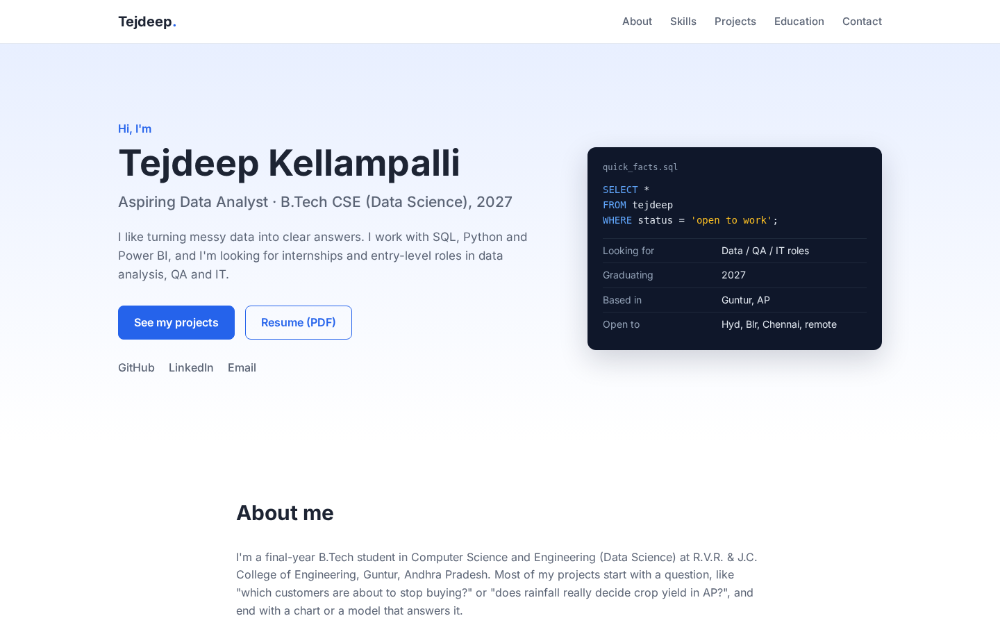

# My Portfolio

My personal website: projects, skills, education and contact details.

**Live:** https://tejdeep-67.github.io/My-Portfolio/



## Built with

Plain HTML, CSS and JavaScript. No framework or build step, so it loads fast and is easy to host on GitHub Pages.

- Responsive layout (CSS grid + flexbox), mobile menu under 760px
- Sections: about, skills, projects, education & certifications, contact
- Resume PDF in `assets/`

## Run locally

Just open `index.html` in a browser, or:

```bash
python -m http.server 8000
```

## Deploy

Settings > Pages > Deploy from branch > `main` / root.
